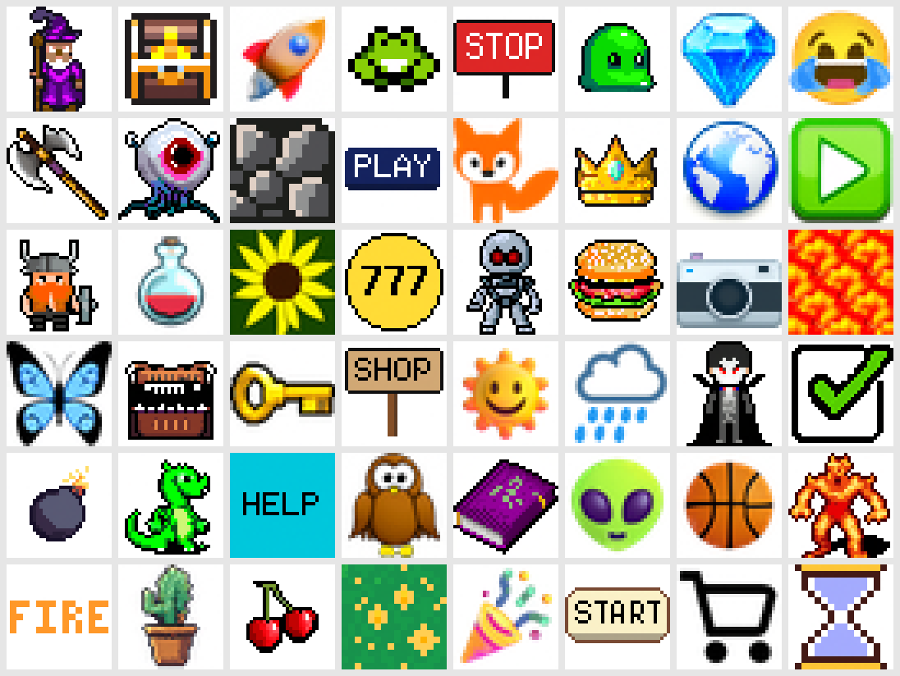
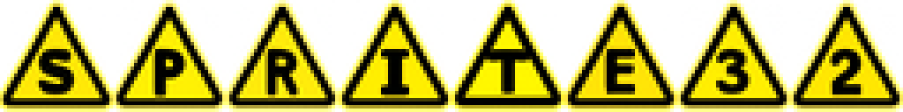
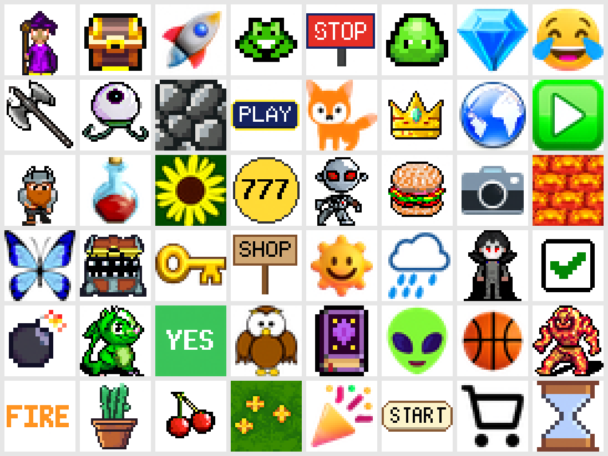

# sprite32

Text in, 32x32 RGBA sprite out: pixel art, icons, emoji and short bits of text.

Try it online at [sprite32.com](https://sprite32.com).



These are picked by hand from 16 seeds per prompt. The prompts and seeds are in
[release/samples.md](release/samples.md).

It is a diffusion model trained from scratch on 660k images. The image side is a 143M-parameter UNet that
works directly on pixels. Training was 500k steps on one RTX 5090, about 20 hours.

There are two versions:

| | sprite32 1.0 | sprite32 1.0 fast |
|---|---:|---:|
| Text encoder | Qwen3-4B, frozen | Qwen3-0.6B, fine-tuned to stand in for it |
| UNet passes per image | 70 | 12 |
| One sprite on an RTX 5090 | 0.88 s | 0.16 s |
| One sprite on a 16-core CPU | 4.0 s | 0.70 s |
| Peak GPU memory | 9.1 GiB | 2.6 GiB |
| Download, text encoders included | about 8.7 GB | about 2.3 GB |

Fast is the same UNet, trained a little further so that it gives the guided result in one pass instead of
two, and it gets by on 12 steps instead of 35. Start with it. The full model scores a little better (see
[Numbers](#numbers)) and is the only one where you can change the guidance.

## Run it

```sh
git clone https://github.com/danemarguglio/sprite32
cd sprite32
python -m venv .venv && . .venv/bin/activate
pip install -r requirements.txt
hf download danemarguglio/sprite32 --include "sprite32-1.0-fast/*" --local-dir weights
python hf_sample.py weights/sprite32-1.0-fast --steps 12 --n 8 --seed 1 --out sword.png \
    --prompts "pixel art green sword sprite with a brown handle"
```

The weights are on [Hugging Face](https://huggingface.co/danemarguglio/sprite32). The fast version's folder is
1.8 GB, and its first run fetches the CLIP B/32 text model on top of that: about 2.3 GB in all, as in the table.

For the full model, download `sprite32-1.0/*` instead and leave out `--steps 12`. Its first run also fetches
Qwen3-4B (about 8 GB). The full model runs on an Apple-silicon Mac too; the fast one has only been tried on
Linux, on a GPU and on the CPU.

It writes `sword.png`, a grid of the sprites over white, and `sword.rgba.png`, the same grid with
transparency. The training captions say what the thing is and name a style ("pixel art", "flat emoji", "3D
icon", "line icon"), so write prompts that way.

`scripts/sprite_web.py` serves a small page for generating from a phone.

### Sprites that match

Two prompts that differ in one word give two different sprites, outline and all. `scripts/consistent.py`
draws a set from one template so that only the filled-in part changes:

```sh
python scripts/consistent.py weights/sprite32-1.0-fast --steps 12 \
    --template "yellow warning triangle with a black {}" --word SPRITE32 --out word/
```



All sprites of a set start from the same noise and share one image through the early, noisy steps, where the
shape and colours are decided; they separate for the late steps, where the letter appears. The script does
that for 8 seeds and keeps the set that is most alike among those whose letters read right. `--items sword
shield key` fills the template with words instead of letters; that works less well, because items differ
in more than a small patch.

`scripts/consistent_web.py weights/sprite32-1.0-fast --steps 12` serves a page for the same thing: template
and word in, the picked set and every other seed it tried out.

## Numbers

10,000 samples per model, scored against 5,000 held-out images. One run each.

| | 1.0 | 1.0 fast |
|---|---:|---:|
| FID, long captions | 6.61 | 6.88 |
| FID, short captions | 7.31 | 7.52 |
| Held-out strings spelled exactly right | 41% | 40% |
| Samples that copy their training caption's image | 2.1% | 1.4% |

A perfect model would score an FID of about 6.5 against a reference this small. A misspelled string is
usually one character off.



The same prompts from the fast model, again picked from 16 seeds. It never got HELP right, so that square
says YES. It also had fewer good seeds to pick from for the wizard, the robot, the fox, the rain cloud and
the lava tile.

Both are 32x32 only. The rest is in [release/MODEL_CARD.md](release/MODEL_CARD.md).

## Data

660,585 images from 270 sources. 60,000 are short strings rendered by a script in this repo. The rest are
public-domain, permissive, CC BY, share-alike and GPL-family art. The images are not in the repo.

Licence checking was best effort. [SOURCES.md](release/SOURCES.md) has the licence of every source,
`release/attribution.tsv.gz` has a row per image, [NOTICE.md](release/NOTICE.md) covers the share-alike and
GPL sources, and [DATASHEET.md](release/DATASHEET.md) says how the set was put together.

## Code

- `hf_train.py`, `hf_sample.py`, `hf_eval.py`: training, sampling and FID. `hf_common.py` has the UNet and
  the EDM maths, `hf_text.py` the text encoders, `hf_data.py` the dataset. Config in `configs/sprite32.yaml`.
- `distill_text.py`, `distill_guidance.py`: how the fast version was made.
- `scripts/`: benchmark, web UIs and the steps before training (text cache, near-duplicate clusters).
- `BENCHMARK.md`: how the model is scored.

The training set is not in the repository; `release/DATASHEET.md` describes it. Config and benchmark refer to
it by its local folder names: `data_v13` is what 1.0 was trained on, `data_v12` an earlier collection that the
benchmark holdout is drawn from, and `curation/` holds the lists that go with them.

## Licence

Code and weights: [Apache-2.0](LICENSE). Copyright 2026 Dane Marguglio.

The training images keep their own licences and are not distributed here; [NOTICE.md](release/NOTICE.md)
says what they are. The fast version's text encoder is a fine-tuned copy of
[Qwen3-0.6B](https://huggingface.co/Qwen/Qwen3-0.6B) (Apache-2.0) and ships with the weights. Qwen3-4B and
CLIP B/32 are downloaded from their own repositories under their own licences.
