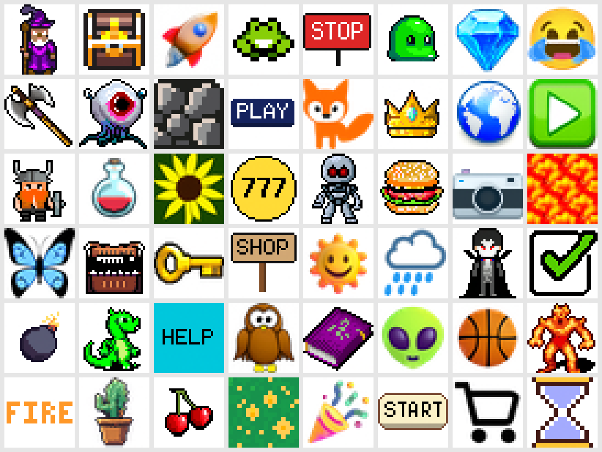
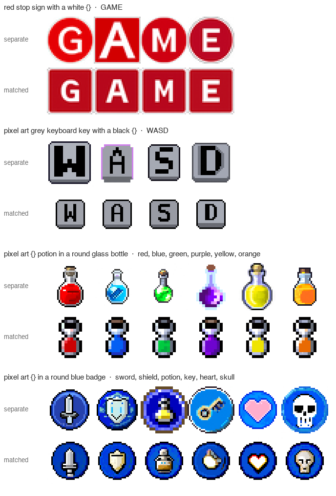

# sprite32 1.0

Text to 32x32 RGBA sprites: pixel art, icons, emoji-style images and short rendered text. Trained from
scratch on 660k images. Code: https://github.com/danemarguglio/sprite32



Hand-picked from 16 seeds per prompt; `samples.md` lists the prompts and seeds, and `samples_fast.png` is
the same sheet from the fast version.

There are two versions. **sprite32 1.0** is the model as trained. **sprite32 1.0 fast** is distilled from it:
a much smaller text encoder and 12 UNet passes per image instead of 70.

| | 1.0 | 1.0 fast |
|---|---:|---:|
| Text encoder | Qwen3-4B, frozen, not included | Qwen3-0.6B, fine-tuned, included |
| Sampling | DPM-Solver++ 2M, 35 steps, guidance 3 | DPM-Solver++ 2M, 12 steps, guidance built in |
| One sprite on an RTX 5090 / on a 16-core CPU | 0.88 s / 4.0 s | 0.16 s / 0.70 s |
| Peak GPU memory | 9.1 GiB | 2.6 GiB |
| Download, text encoders included | about 8.7 GB | about 2.3 GB |

```sh
git clone https://github.com/danemarguglio/sprite32 && cd sprite32
pip install -r requirements.txt
hf download danemarguglio/sprite32 --include "sprite32-1.0-fast/*" --local-dir weights
python hf_sample.py weights/sprite32-1.0-fast --steps 12 --prompts "pixel art cow, side view" --n 8 --seed 1 --out cow.png
```

For the full model download `sprite32-1.0/*` and leave out `--steps 12`.

## What it is

- **Image model:** a diffusers `UNet2DConditionModel` with three levels (128 / 256 / 512 channels, two blocks
  per level, self- and cross-attention at every level, QK-norm attention), 143.5M parameters including the text
  adapter. It works on 32x32 premultiplied RGBA and is trained with EDM preconditioning and learned
  uncertainty weighting.
- **Text side:** token states of `Qwen/Qwen3-4B` (second-to-last layer, up to 63 tokens) go through a
  two-block adapter into cross-attention; the pooled state of `openai/clip-vit-base-patch32` is added to the
  embedding stream. Both are frozen and are downloaded from their own repositories under their own licences.
- **Labels:** quality and category labels were used in training; sampling uses quality 5 and no category.
- **Files:** `unet_ema0.9999/` (548 MB, fp32), `scheduler/`, `run_config.json`.

## The fast version

Two changes to the model above, both made by training against it rather than against the data:

- **Text encoder.** `Qwen/Qwen3-0.6B` (596M parameters) was fine-tuned for 30,000 steps to produce, together
  with a copy of the adapter, what the UNet gets from Qwen3-4B. It uses the same tokenizer. It only ever saw
  the training captions, so prompts that read very differently are less covered than the numbers below show;
  that has not been measured. The CLIP vector is unchanged.
- **One pass per step.** Guidance normally takes two UNet passes per step, one with the caption and one
  without. A copy of the UNet was trained for 40,000 steps to give the guided result from the caption pass
  alone. The guidance is fixed at 3 and cannot be changed when sampling.

After that, 12 steps score about the same as 35 (FID 6.83 / 7.39 against 7.02 / 7.64 with Qwen3-4B as the
text encoder); 8 steps are visibly worse (11.28 / 10.65).

Files: the same as above plus the fine-tuned Qwen3-0.6B (1.2 GB, fp16), which is a modified copy of an
Apache-2.0 model.

## Matching sets

Two prompts that differ in one word normally give two unrelated sprites. `scripts/consistent.py` draws a set
from one template so that only the filled-in part changes:



```sh
python scripts/consistent.py weights/sprite32-1.0-fast --steps 12 --tries 16 \
    --template "red stop sign with a white {}" --word GAME --out game/
```

Nothing is retrained for this. All sprites of a set start from the same noise. Through the early, noisy
steps, where shape and colours are decided, every sprite is steered by the average of what the prompts ask
for, so they all get the same frame. For the last steps each follows its own prompt, and the letter or item
appears. The script does this for several seeds, checks with the model itself which sprites fit their own
prompt better than the other prompts (for letters: better than any other letter or digit), and keeps a set
where the most sprites pass and the fewest pixels differ.

Letters and colours work best. Items that differ in shape share less: in the badge row the key came out as
something else. The figure is from the fast version, 16 seeds tried per set.

## Training

- 500,000 steps at batch 128 on one RTX 5090 (20.3 hours), bf16, learning rate 1e-4 with a 4,000-step warmup
  and a cosine tail from step 375,000 to 10%.
- 653,980 training images and 6,605 validation images (`DATASHEET.md`). Each image has a short and a long
  caption; one is drawn at random. Captions are dropped 10% of the time for guidance.
- Sources are sampled with weight (source size)^0.7. Each image is capped at 150 expected draws over the run
  and each cluster of near-duplicates at 200. Flat black icons are drawn in another colour half of the time,
  with the colour word changed in the caption.

## Evaluation

Held-out set: 5,000 images that were never trained on, with long and short captions. 10,000 samples per
model with its own sampler settings from the table above (`BENCHMARK.md`). One run each, so small
differences between the columns may be noise.

| Measure | 1.0 | 1.0 fast |
|---|---:|---:|
| FID, long captions | 6.61 | 6.88 |
| FID, short captions | 7.31 | 7.52 |
| CLIP score, long / short | 27.03 / 26.52 | 27.00 / 26.42 |
| Held-out strings spelled exactly (60 strings, 1,376 samples) | 41.1% | 39.5% |
| Strings spelled exactly in at least one sample | 85% | 80% |
| Seed pairs that are near-identical (50 prompts, 8 seeds) | 3.6% | 0.9% |
| Samples within RMSE 10 of a training image, training captions | 4.4% | 3.2% |
| ...of which the caption's own image | 2.1% | 1.4% |
| Samples within RMSE 10 of a training image, held-out captions | 3.3% | 3.0% |

For scale, 16.3% of the real held-out images are within RMSE 10 of a training image, and a perfect model
would score an FID of about 6.5 against a reference of this size. With the benchmark script's own sampler
(Heun, 20 steps) the full model scores 6.83 / 7.47. The held-out set was drawn before the last 137,618
images were added to the training set, so those sources are not represented in it.

## Limitations

- **Spelling:** wrong text is usually legible with one wrong, missing or swapped character ("HELP!" comes out
  as "HEP!"). Five-character strings are spelled exactly 16% of the time (fast: 22%); two- to four-character
  strings 32% to 58% (fast: 28% to 55%).
- **Reproducing training images:** about 2% of samples from training captions are near-copies of that
  caption's own image. In a review of 87 near-copies they were rendered text (which the caption fully
  specifies), simple one-colour icons, tile sprites, and frames of one character set from OpenGameArt that
  has many near-identical frames.
- **Low variety on some prompts:** a few emoji prompts (a gradient folder icon, a running man emoji) give
  nearly the same image for every seed.
- **Logos and characters:** some icon sets in the training data contain product logos and some game art
  depicts existing characters. The model can draw things that resemble them; trademarks and character rights
  stay with their owners.
- **Fast version:** on the 48 prompts of the sample sheet it had fewer usable seeds than the full model for
  some subjects (a wizard, a robot, a fox, a rain cloud, a lava tile) and wrote "HEEP" for HELP on all 16
  seeds. That is one hand-picked set of prompts, judged by eye.
- 32x32 only. The output is small and the model is not a general image generator.

## Training data and licences

The training images come from 270 source folders under public-domain, permissive, attribution, share-alike
and GPL-family licences, plus 60,000 text images drawn by a script in this repository. Licence checking was
best effort: 46% of the images have a licence read from the upstream licence file or page, 27% are verified
with conditions (attribution, share-alike, copyleft or a trademark note), 18% carry the licence stated by the
source or its mirror without the upstream page being fetched, and 9% are generated. Sources that ask not to be
used for AI training were left out where that was known.

- `SOURCES.md`: licences and counts per source.
- `attribution.tsv.gz`: licence, author, title and URL for every training image.
- `NOTICE.md`: what the attribution, share-alike and GPL sources are, and what is and is not claimed.
- `DATASHEET.md`: what is in the set and how it was collected and filtered.

No images generated by another text-to-image model are in the training set.

## Licence

Weights and code: Apache-2.0. The training data is not redistributed with the model and keeps its own
licences; `NOTICE.md` lists the attribution, share-alike and GPL sources and what follows for samples that
reproduce a training image.
